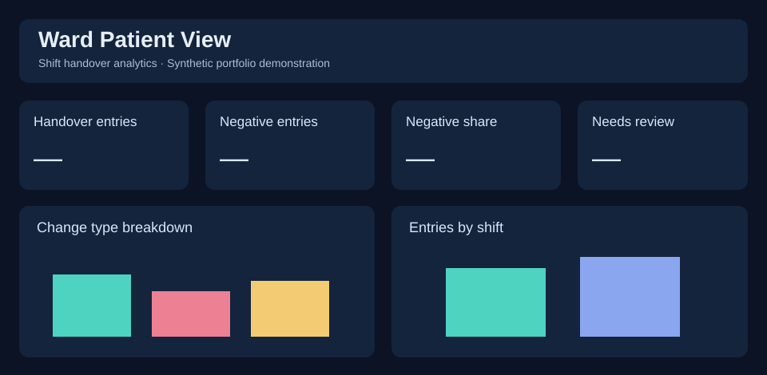

# Ward Patient View — Shift Handover Dashboard

**Excel dashboard concept | Interactive GitHub Pages demonstration | Synthetic data only**

> ⚠️ This repository contains **generated synthetic records** and is **not a clinical system**. No source workbook, patient details, or staff records are published.

## Overview
A portfolio demonstration of an Excel-based ward shift-handover dashboard concept, focused on changes in observation status, reporting workload, and visibility of handover information. The original workbook has four worksheets: `Dashboard`, `Source Data (original)`, `Patient Roster`, and `Shift Handover Log`.

## [Open the live dashboard](https://AdeoluBada.github.io/ward-patient-view-dashboard/)

*Link will work **only after GitHub Pages deployment**.*

## Business problem
Important observations can be difficult to identify quickly in shift handovers. This demonstration explores how structured records and colour-coded change indicators can support review and operational reporting. No improvement in patient outcomes is claimed or measured.

## Features
- Filter entries by shift, change type, and category
- Track total entries, negative changes and percentage negative
- Identify the most recent filtered change per demonstration patient
- Show distribution by shift, reporting role, and day
- Display status using green (positive), red (negative), amber (neutral)

## Technology
The **source workbook** uses Microsoft Excel, including formulas and conditional formatting. The **published demonstration** uses HTML, CSS, JavaScript, Chart.js, and synthetic JSON/CSV data. SQL and Power BI are **not used in this repository**.

## KPI definitions
See [KPI documentation](docs/kpi_definitions.md). Metrics are calculated on the selected filtered records. They are descriptive and not clinical decision support.

## Data and privacy
`data/sample_data.csv` and `.json` contain programmatically generated demonstration records with fictional identifiers. They do not reproduce original names, notes, identifiers, or medical details. The original workbook must **not** be uploaded to this public repository.

## Project documents
- [Methodology](docs/methodology.md)
- [Data dictionary](docs/data_dictionary.md)
- [KPI definitions](docs/kpi_definitions.md)
- [User guide](docs/user_guide.md)
- [Project overview](docs/project_overview.md)
- [LinkedIn copy](docs/linkedin_content.md)
- [Deployment steps](docs/deployment.md)

## Limitations and future development
- The synthetic dataset is illustrative, not a validated operational dataset.
- This static site does not execute Excel formulas, Power Query, or native Excel slicers.
- Latest-entry logic is based on record order within date and shift; there are no event timestamps in the source log.
- Potential future work: add timestamps, quality checks, trend comparisons and an approved secure data integration.

## Author
[Adeolu Bada on GitHub](https://github.com/AdeoluBada) · [LinkedIn](https://www.linkedin.com/in/adeolu-bada-165506b1/)

## Licence
MIT licence applies to this demonstration's code and documentation, not to any original workbook or third-party data.
